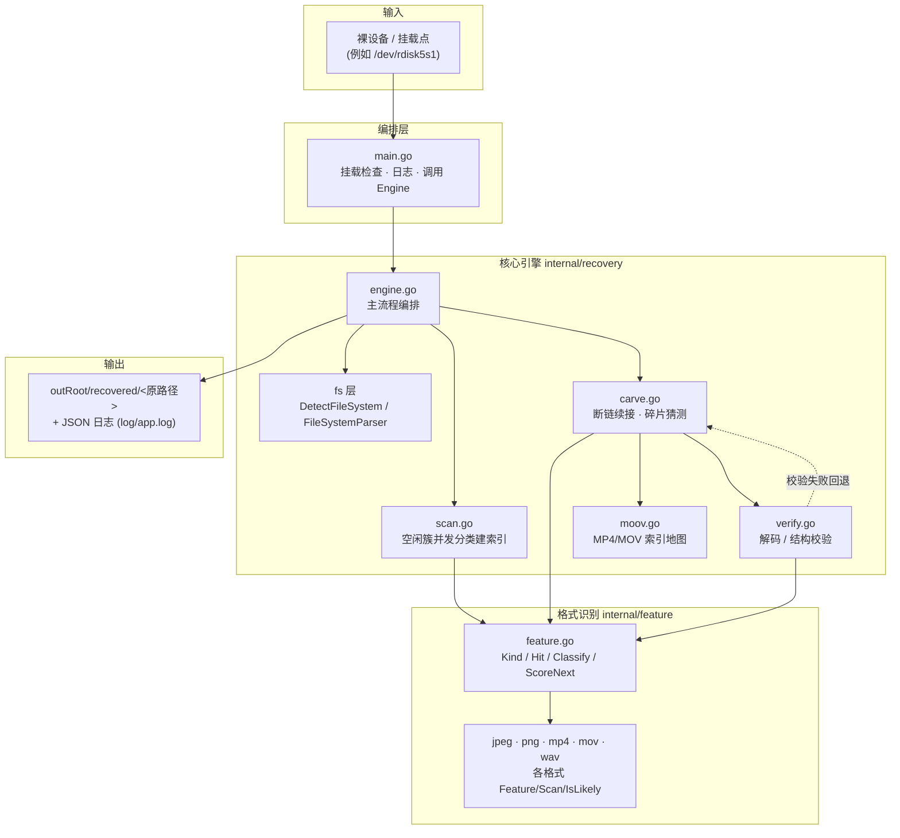
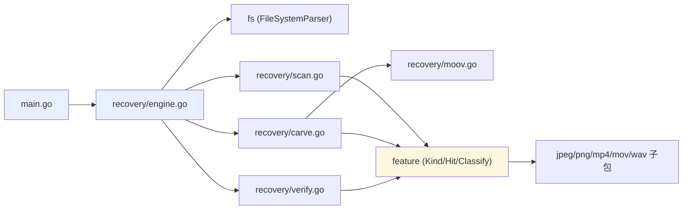
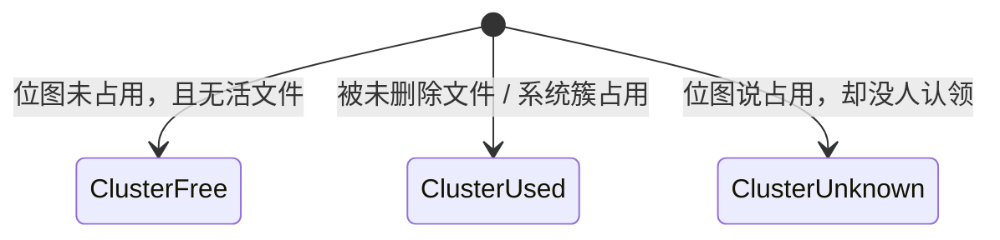
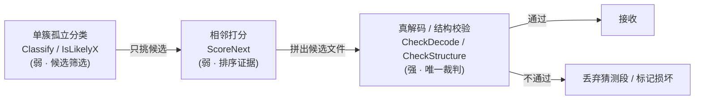
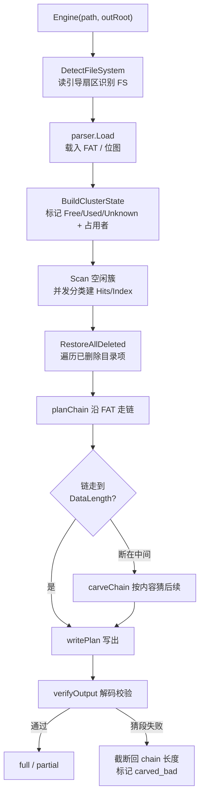
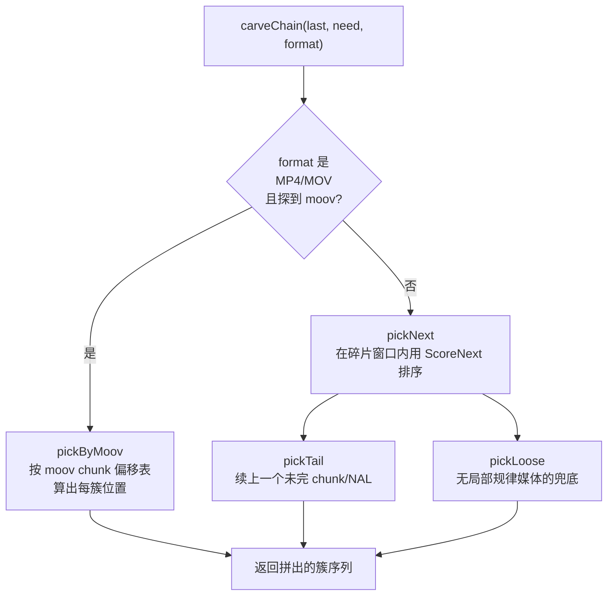

# progrescarve 架构与恢复流程说明

> 面向开发者 / 维护者的系统设计文档。介绍 progrescarve（一个 FAT/exFAT 卡上已删除文件的
> 内容雕刻恢复工具）的整体架构、模块职责、核心数据结构、恢复主流程，以及"断链续接"这一
> 最关键的技术环节。文档中涉及的代码位置以 `文件:行` 形式标注，便于对照源码。

---

## 1. 系统概览

progrescarve 的目标是：**从一张已删除文件的存储卡（裸设备或挂载点）上，把还能救回来的
已删除文件按原路径还原出来**。它既不依赖文件系统的"未分配"标记，也不只信目录项 —— 它
把"文件系统元数据能确认的"和"靠内容特征猜出来的"分开记账，最后用**真解码器**做唯一权威
校验。

核心约束（来自代码注释，也是整套设计的出发点）：

- **不能把整张卡的原始簇数据留在内存**。一张 1TB 的卡空闲簇上百万，留住就是几十 GB。
  所以扫描阶段只提取每簇的**紧凑特征 `Feature`**，要回看原始内容时按簇号 `ReadCluster`
  重新读盘（`scan.go:12-16`）。
- **元数据确认的，优先于任何猜测**；猜出来的部分一律单独记账（`chainPlan.guessed`），
  不和有指针可达的簇混为一谈（`engine.go:269-276`）。
- **解码器是唯一裁判**。"内容特征 / 相邻打分 / 簇号距离"这些判据只能说"没发现不对"，
  只有解码器能说"这份文件是通的"（`engine.go:577-586`）。



---

## 2. 分层架构与模块职责

系统分三层，依赖方向单向向下：`main → recovery → feature`，`recovery → fs`。

### 2.1 编排层 `main.go`

- 校验目标卡是真正的挂载点（`isMountPoint`），否则数据会误写到系统盘（`main.go:42-61`）。
- 配置双份日志：终端文本日志（给人看）+ 文件 JSON 日志（带源码位置，事后翻）
  （`main.go:69-92`）。
- 调用 `recovery.Engine(path, outRoot, pre, logger)`，失败即非零退出，不让 CI 误判成功
  （`main.go:120-125`）。
- 完成后起一个 gin 健康检查服务（`:8080`），方便外部探活。

### 2.2 文件系统层 `internal/fs`

- `DetectFileSystem` 只读引导扇区 512 字节，按偏移 3 的签名识别。**当前已接线的只有
  exFAT**（`"EXFA"`）；`fat32/`、`ntfs/` 子包存在但尚未进入识别分支（`fs.go:19-32`）。
- `fsinit.FileSystemParser` 是统一抽象，提供：`Load`、`ClusterHeapRange`（簇大小/起止）、
  `ReadCluster`（按簇号读，位置无关、可并发）、`GetClusterFSInfo`（查 FAT 下一簇）、
  `DebugPrintMeta`。`recovery` 全程只依赖这个接口，不关心具体文件系统。

### 2.3 核心引擎 `internal/recovery`

`engine.go` 顶部注释点明了四个文件的分工：

| 文件 | 职责 |
|------|------|
| `engine.go` | 主流程：识别 FS → 建簇状态表 → 扫空闲簇 → 恢复条目 → 写盘 + 校验 |
| `scan.go`   | 把空闲簇并发读一遍，按内容分类，建出"簇号 → 特征"索引 |
| `carve.go`  | 目录项给的簇链断掉时，靠内容特征把后续碎片猜回来 |
| `verify.go` | 雕刻出的文件按格式交给解码器 / 结构校验器验收 |
| `moov.go`   | MP4/MOV 专属：探测并加载 `moov` 索引地图 |
| `inspect.go`| 把识别到的特征打到日志，便于事后核对 |

### 2.4 格式识别层 `internal/feature`

- `feature.go`：定义 `Kind`（每种格式的头 / 碎片两类）、`Hit`（一份簇命中，`*Xxx.Feature`
  指针按格式挂载）、`Classify`（单簇分类入口）、`ScoreNext`（两簇相邻打分）、以及
  `IsFileStart/Head/End/Payload` 等格式无关判定。
- 各格式子包（详见第 5 节）各自实现 `Scan / IsLikelyX / ScoreNext / Check*`，**与文件系统
  完全解耦**——`recovery` 只通过 `feature` 包的公共接口使用它们。



---

## 3. 核心数据结构与设计前提

### 3.1 簇占用三态 `ClusterState`

恢复前先用 `BuildClusterState` 给每个簇打标签（`engine.go:27-37`）：



- **`ClusterFree`** 与 **`ClusterUnknown`** 都要扫：实测删文件时 FAT 清了、位图却未必清，
  造成"标着已分配却无人认领"的簇，里面装的正是被删文件的残骸。只扫 `Free` 会整片跳过
  它们（`scan.go:115-120`）。
- **`ClusterUsed` 不扫**：那是活文件正在用的数据，拿来拼被删文件只会拼错。

### 3.2 扫描结果 `ScanStats`

`Scan` 并发读簇（`scanWorkers = 8`、`scanLimit = 100_000` 簇上限），每簇 `feature.Classify`
后只保留簇号与特征，绝不存原始数据（`scan.go:112-217`）：

- `Hits map[Kind][]uint32`：按类别汇集命中簇号，用于**按格式遍历 / 日志报数**。
- `Index map[uint32]Hit`：按簇号反查，用于**续接时判断某簇能不能用**。
- `ScannedUpTo`：区分"扫过但什么都不像（已污染）" vs "压根没扫到（不作判断）"。
- `fragments`：把所有格式的碎片候选合并成一张升序表，雕刻时只在这张表上二分取窗口
  （`scan.go:46-52`）。

### 3.3 一次命中的载体 `Hit` 与 `Feature`

`Hit` 把每种格式的特征以指针形式挂上来，一份簇只属于一种格式：

```
Hit { Kind; Cluster; JPEG *jpeg.Feature; MP4 *mp4.Feature; PNG *png.Feature;
      MOV *mp4.Feature; WAV *wav.Feature }
```

`Feature` 各格式不同，但都遵循同一套设计哲学：**紧凑、可丢弃原始数据、为相邻打分提供证据**。
以 PNG 为例，`Feature` 记录"从簇首能顺着分块结构走通多少字节（`ChunkWalkEnd`）"、
"几个 chunk（`ChunkCount`）"、以及**簇边界状态（`TailState`/`HeadState`）"——后者正是
跨簇拼接的判据。

### 3.4 两阶段判据（贯穿全局的设计）



- **第一阶段（弱）**：孤立地看一簇，只判断"像不像某格式的候选"。很多媒体数据（视频
  mdat、PCM 采样）孤立看根本不可判——这被明确写进 `feature.go` 的注释，是整套系统的已知
  局限。所以弱判据只负责"挑候选"，绝不"确认"。
- **第二阶段（强）**：把拼出来的整份文件交给解码器（JPEG/PNG）或结构校验器
  （MP4/MOV/WAV）。只有它说通了，才算恢复成功。

---

## 4. 恢复主流程

`Engine` 是一条线性流水线（`engine.go:988-1068`），再用目录项逐个恢复已删除文件。



### 4.1 沿链走：`planChain`

对每个已删除条目，从 `FirstCluster` 起沿 FAT 走（`engine.go:303-480`），规则极克制：

1. **撞上 `ClusterUsed`**（活文件占着）→ 记 `OverwrittenError`，前半段照收，链到此为止
   （`engine.go:343-357`）。
2. **第一簇必须自证**是文件头：目录项给的只是簇号，删除后那簇可能早被覆盖。`checkFirstCluster`
   校验"第一簇确实是该格式头"，否则直接放弃，避免写出打不开的假阳性（`engine.go:359-367`）。
3. **格式首簇定**：第一簇命中头类别最好；命中非头类别或干脆不像时，**回退按扩展名兜底**
   （`classifyFormat`，`engine.go:279-301`）——否则 `.jpg` 会静默跳过校验。
4. **链在 DataLength 之前停**（`ShortChainError`）：前半段完好，后半段无指针可达，交给
   续接逻辑猜回来（见第 5 节）。

> 断点成因靠 `ShortChainError.LastFatNext` 区分（`engine.go:72-86`）：`0` = 簇被释放
> （旧数据通常还在）；`0x0FFFFFFF` = 真链尾 EOC，是目录项的 DataLength 与链不自洽，
> 条目本身不可尽信。两种成因前段都完好，一律截断交付。

### 4.2 写出与校验：`writePlan` / `verifyOutput`

- 写盘顺序是 `chain ++ guessed`：先写有指针可达的簇，再写猜出来的簇（`engine.go:509-535`）。
- **整份**过解码校验，不只对猜的那段——FAT 残留项也可能指向早被覆盖的簇（`engine.go:577-586`）。
- 校验失败且存在 guessed 段时：**直接 `Truncate` 回 chain 长度**即可，因为猜的字节全在文件
  尾部，无需把 chain 从源盘重读一遍（`engine.go:560-564`）。猜错的簇从全局认领表撤回。
- 全局 `claims` 认领表（簇号 → 条目路径）防止两个残缺文件把同一簇各自写进自己输出
  （`engine.go:420-429`、`470-476`）。

### 4.3 结果分类

`Engine` 末尾汇总并分开报（`engine.go:1052-1064`）：

- `full`：链完整走通、校验通过；
- `partial`：断链但前段校验通过；
- `carved`：靠内容猜出了后续碎片且校验通过；
- `carved_bad`：猜出的那段校验没过、已被截断回退；
- `failed`：无法解释的错误（越界、成环、FAT 读失败）。

---

## 5. 断链续接（carve）与格式识别原理

这是 progrescarve 最见功夫的一段：**当 FAT 链断在 DataLength 之前，后半段没有任何指针
可达，只能按内容特征去找**。入口在 `carveChain`（`carve.go`），内部三路择优：



1. **moov 地图**（`moov.go` + `pickByMoov`）：MP4/MOV 先"探 moov"——谁都去探一次，探到
   `moov` 本身就是"这是 MP4 且地图可用"的硬证据，不需要任何前置格式判定（`engine.go:450-462`）。
   命中后按 moov 里的 chunk 偏移表直接算出后续每簇该落在文件第几字节，最准。
2. **`pickNext` + `pickTail`**：在 `fragments` 候选窗口内用 `ScoreNext` 给每对相邻簇打分，
   选最可能续上的；`pickTail` 处理"上一簇的 chunk/NAL 跨边界没写完"的续接。
3. **`pickLoose` 兜底**：视频 mdat、WAV 的 data 块**在字节层面没有任何局部规律**，孤立一簇
   根本认不出来（`feature.go` 注释反复强调）。于是换依据——不要求候选自证是媒体，只排除
   "它其实是别的东西"（被活文件占着 / 已被认领 / 被扫成别种格式 / 是某文件的头），剩下
   "扫过但什么都不像"的就是要的（`carve.go` `pickLoose`）。

### 5.1 五种格式识别原理对比

| 格式 | 文件头 | 内部结构 / 锚点 | 结束标记 | 校验方式 | 碎片识别难点 |
|------|--------|----------------|----------|----------|--------------|
| **JPEG** | `FF D8 FF` | 熵编码流 + **字节填充 `FF 00`** + 循环**重启标记 `FF D0~D7`**（跨簇硬锚点） | `FF D9` (EOI) | `image/jpeg.Decode` | 熵流任意字节可接任意字节，靠重启标记相位 |
| **PNG** | 8 字节签名 | **分块结构**：`长度(大端)+类型+数据+CRC` | `IEND` | `image/png.Decode`（验 CRC+zlib） | 落在 IDAT 压缩流中间的簇孤立不可判 |
| **MP4** | `ftyp` 盒子 | ISO 盒子 + `moov` 偏移地图 | 无（靠 DataLength） | `mp4.CheckStructure` | mdat 无局部规律，靠地图 / 兜底 |
| **MOV** | `ftyp` 或 `moov` 开头 | 与 MP4 同一套容器，复用 `mp4.Feature` | 无 | `mov.CheckStructure`（容忍 moov 开头 / wide·free） | 老式 QuickTime 无 ftyp，需 `mov.IsMOVHeader` |
| **WAV** | `"RIFF"`+`"WAVE"` | RIFF 分块（**长度小端**、ID 可含空格、无 CRC） | 无（靠 DataLength） | `wav.CheckStructure`（验 fmt 字段） | data 块 PCM 近似随机，孤立不可判 |

> **骨架一致、判据不同**：五种格式的包都遵循 `Feature + Scan + IsLikelyX + ScoreNext +
> Check*` 同一套骨架（`feature.go` 把它们统一接进 `Kind`/`Hit`/`ScoreNext` 分发）。但底层
> 锚点完全不同——JPEG 靠重启标记相位，PNG/WAV 靠分块结构走通，MP4/MOV 靠 moov 地图。
> "证明接对了"最终全部交给第 4.2 节的强校验。

### 5.2 为什么 MOV/WAV 复用而非另起一套

- **MOV 与 MP4 是同一套 ISO 基媒体容器**：`mov` 包明确"Scan/ScoreNext/moov 地图全复用
  mp4"，所以 `Hit.MOV` 的类型就是 `*mp4.Feature`，只把 `Kind` 拆开（`KindMOVHeader`/
  `KindMOVPayload`），避免重复实现。
- **WAV 与 PNG 同理是分块结构**，但 RIFF 用**小端**、chunk ID 允许空格、且无 CRC/结束标记；
  Go 标准库没有 WAV 解码器，故 `wav.CheckStructure` 做结构校验而非真解码。

---

## 6. 已知缺口与 TODO（测试与评估）

本节记录当前实现在**测试覆盖**与**工程评估**上的空白。结论是：简单路径已经能跑通，但
"能不能在真实数据上跑好"这件事**还没有被系统验证过**。

### 6.1 现状：简单 case 走了，复杂 case 没走

- ✅ **已验证（简单 case）**：单文件、目录项 + FAT 链基本完好、格式特征明显的样本（例如
  第一簇未被覆盖的 JPEG/MP4）能正确识别、拼接、解码通过；`go build` / `go vet` 全绿。
- ❌ **未验证（复杂 case）**：以下场景目前只在代码注释里被预警，没有对应的样本或自动化
  用例去落实：
  - **第一簇被覆盖**的已删除文件（`checkFirstCluster` 会直接放弃，需确认回落行为合理）；
  - **目录项 DataLength 与 FAT 不自洽**（`ShortChainError.LastFatNext == EOC`）；
  - **高碎片度**：同一文件碎片散落全卡、`pickLoose` 兜底大量命中时的正确性与召回率；
  - **连续分配（NoFatChain）断点**：`engine.go:389-396` 明确写了"分数打出来了，但还没标定
    多低算断"，现网是照常收下、不拦断点；
  - **多文件争抢同一簇**：`claims` 认领表目前"一次认到底、无回溯"（`engine.go:422-424`、
    `470-476`），猜错时无回滚；
  - **非 exFAT 文件系统**：`fat32/`、`ntfs/` 子包存在但未进入 `DetectFileSystem` 识别分支。

### 6.2 待补的测试

- [ ] **单元测试**：每种格式的 `Scan / IsLikelyX / ScoreNext / Check*`（签名、分块走通、
      跨边界 Tail–Head 咬合、误判样本）。PNG/MOV/WAV 是新接入的，用例尤其缺失。
- [ ] **carve 集成测试**：构造"FAT 链在 DataLength 之前断"的模拟盘，验证 `carveChain`
      三路（moov 地图 / pickTail / pickLoose）各在什么条件下命中、拼接结果能否通过 `verify`。
- [ ] **端到端（e2e）样本测试**：用真实删卡镜像（或合成镜像）跑 `Engine`，对 `full /
      partial / carved / carved_bad / failed` 各分类做断言，而不只是看日志不报错。
- [ ] **回归基线**：把"已知能救回"的样本固化为 `testdata/` 用例，避免后续改动静默退化。

### 6.3 待做的工程评估（压测 / 时间 / 有效性）

| 维度 | 当前状态 | 需要补的评估 |
|------|----------|--------------|
| **压测** | 未做。`scanLimit=100_000` 簇、`scanWorkers=8` 是按"先扫一轮看分类"设的占位值，不是性能结论 | 在真实 1TB 卡上测：扫描耗时、内存峰值（应 ≈ 特征索引体积，而非原始簇体积）、并发读在 HDD/SSD 上的吞吐差异 |
| **时间预估** | 无。`Engine` 注释提到"1TB 得几分钟"是口头估计，未实测 | 给出扫描 / 恢复两阶段的耗时曲线，作为可交付的 SLA |
| **有效性（召回 / 精确率）** | 未量化。只知"简单 case 通"，不知道复杂碎片下救回多少、误救多少 | 在带标签的合成盘上统计：各格式的召回率、carved 段被 `verify` 推翻的比例（`carved_bad`）、误报率 |
| **正确性边界** | 靠注释 `TODO` 记录（`NoFatChain` 断点、`claims` 回溯、扩展名兜底短路） | 把每个 `TODO` 落成"标定阈值 + 开关 + 测试" |

> 一句话：**逻辑骨架已闭环，但"在真实复杂数据上跑得好不好"这件事，目前是未被证实的**。
> 第 6.2 / 6.3 的清单就是把它从"能跑"推进到"可交付"的必经之路。

---

## 7. 小结

progrescarve 的设计可以用一句话概括：**用文件系统元数据尽量多地"确证"文件前半段，用内容
特征"猜"出断掉的后半段，最后用解码器一锤定音**。

- **不存原始簇数据** + **紧凑特征** + **按簇号回读**，让 1TB 卡的全盘扫描可行；
- **三态簇标签** + **Free/Unknown 都扫**，把"删了 FAT 却没清位图"的残骸也捞回来；
- **chain 与 guessed 分离记账** + **认领表**，避免残缺文件互相抢簇；
- **两阶段判据**（弱分类 / 强解码）让不确定的拼接绝不被当成确定结果交付。

这套取舍在 `scan.go`、`engine.go`、`carve.go` 的注释里被反复打磨，理解它们，就能理解
progrescarve 为什么是现在这个样子。
